在公有云环境中，LoadBalancer Service 通常由云厂商的负载均衡器实现；但在裸机或普通内网 Kubernetes 环境中，集群本身通常没有对应的 LoadBalancer 实现。因此，如果没有额外部署 MetalLB 等组件，服务一般只能通过 NodePort、hostNetwork 或外部负载均衡器等方式暴露。

然而，MetalLB提供了这一功能，通过IPAddressPool，将同网段的IP地址声明为VIP地址，并通过Speaker宣告此IP，可以让应用通过Load Balancer的方式对外提供应用。

本文将以一个单节点k3s作为实验环境，从0部署MetalLB、IpAddressPool、L2Advertisement等CRD，并以当前博客为Demo，搭建一个使用Load Balancer提供访问能力的博客服务。

# 实验环境
| 用途 | 配置 |
| --- | --- |
| 节点 | `k3s`，`10.211.55.26/24`，`enp0s5` |
| K3s Pod CIDR | `10.42.0.0/16` |
| Calico IPPool | `10.42.0.0/16` |
| Service CIDR | `10.43.0.0/16` |
| Calico | Operator 管理、VXLAN、iptables、BGP 禁用 |
| kube-proxy | iptables |
| ServiceLB/Traefik | 从 K3s 安装时禁用 |
| SELinux | 禁用 |
| firewalld | 禁用，避免干扰 K3s/Calico 规则 |

# 安装k3s

## 节点预处理
确保以下内核能力和ipv4流量转发功能开启

```bash
sysctl net.ipv4.ip_forward
modprobe br_netfilter
modprobe vxlan
# 验证
lsmod | grep -E 'br_netfilter|vxlan'
```

如果 net.ipv4.ip_forward 为 0
```bash
cat >/etc/sysctl.d/90-kubernetes.conf <<'EOF'
net.ipv4.ip_forward = 1
EOF
# 然后应用配置
sysctl --system
```

## 创建k3s配置文件
```bash
cat > /etc/rancher/k3s/config.yaml << EOF
node-name: k3s
node-ip: 10.211.55.26
cluster-cidr: 10.42.0.0/16
service-cidr: 10.43.0.0/16
flannel-backend: none
disable-network-policy: true
kube-proxy-arg:
  - proxy-mode=iptables
selinux: false
disable:
  - servicelb
  - traefik
EOF
```
然后``chmod 600 /etc/rancher/k3s/config.yaml``

## 安装k3s
```bash
curl -sfL https://get.k3s.io | INSTALL_K3S_VERSION='v1.36.4+k3s1' sh -
```
安装完成后，Pod应该都是pending状态，这是正常的，因为目前还没有网络插件

## 安装Calico
1. 安装CRD和Operator
```bash
kubectl create -f https://raw.githubusercontent.com/projectcalico/calico/v3.32.1/manifests/v1_crd_projectcalico_org.yaml
kubectl create -f https://raw.githubusercontent.com/projectcalico/calico/v3.32.1/manifests/tigera-operator.yaml
```

2. 创建与 K3s 对齐的 Installation，以及 Calico 官方 Operator 安装所需的 `APIServer/default`
```bash
cat > /root/metallb/calico-installation.yaml << EOF
apiVersion: operator.tigera.io/v1
kind: Installation
metadata:
  name: default
spec:
  cni:
    type: Calico
  calicoNetwork:
    linuxDataplane: Iptables
    bgp: Disabled
    containerIPForwarding: Enabled
    linuxPolicySetupTimeoutSeconds: 10
    nodeAddressAutodetectionV4:
      kubernetes: NodeInternalIP
    ipPools:
      - name: k3s-pod-cidr
        blockSize: 26
        cidr: 10.42.0.0/16
        encapsulation: VXLAN
        natOutgoing: Enabled
        nodeSelector: all()
---
apiVersion: operator.tigera.io/v1
kind: APIServer
metadata:
  name: default
spec: {}
EOF
```
然后
```bash
kubectl apply --dry-run=server -f calico-installation.yaml
kubectl apply -f calico-installation.yaml
```
`calico-installation.yaml` 固定了 `10.42.0.0/16`、VXLAN、iptables、BGP Disabled、`containerIPForwarding: Enabled`，并用 Kubernetes NodeInternalIP 识别节点地址。

第二份资源 `APIServer/default` 会部署 Tigera API server；缺少它时，`tigerastatus/tiers` 会持续显示 `Waiting for Tigera API server to be ready`。

检查资源状态
```bash
kubectl get tigerastatus
kubectl get apiserver.operator.tigera.io default
kubectl get pods -n calico-system -o wide
kubectl get pods -n tigera-operator -o wide
kubectl get ippools.crd.projectcalico.org -o wide
```
确保资源都存在，并且状态正常

所有 TigeraStatus 必须 `AVAILABLE=True`、`PROGRESSING=False`、`DEGRADED=False`，Calico Pod 必须为 Running状态

3. 验证
```bash
kubectl get node k3s -o jsonpath='nodePodCIDR={.spec.podCIDR}{"\n"}'

kubectl get ippool.crd.projectcalico.org k3s-pod-cidr -o jsonpath='calicoPool={.spec.cidr}{"\n"}vxlanMode={.spec.vxlanMode}{"\n"}'

grep -n '"allow_ip_forwarding": true' /etc/cni/net.d/10-calico.conflist
```

预期结果如下：
```text
nodePodCIDR=10.42.0.0/24
calicoPool=10.42.0.0/16
vxlanMode=Always
```

## 安装Helm
```bash
dnf install -y helm
export KUBECONFIG=/etc/rancher/k3s/k3s.yaml
helm list --all-namespaces
```

K3s 自带的 `kubectl` 默认读取 `/etc/rancher/k3s/k3s.yaml`，独立安装的 Helm 不会自动使用该路径。没有设置 `KUBECONFIG` 时，Helm会尝试连接 `http://localhost:8080`，并返回错误；

后续 Helm 集群操作同时显式传入 `--kubeconfig`，避免因 shell 会话变化而丢失设置。

# 部署MetalLB

## 安装MetalLB Controller
```bash
kubectl apply -f https://raw.githubusercontent.com/metallb/metallb/v0.16.1/config/manifests/metallb-native.yaml
```
## 渲染Envoy Gateway CRD

使用Helm生成 Gateway API standard CRD和Envoy Gateway扩展CRD

注意: Helm 4 在拉取 OCI chart 时会把 `Pulled:` 和 `Digest:` 输出到标准输出，不能把原始标准输出直接作为 Kubernetes YAML。需要将原始输出保存为文件，再从第一个 YAML 文档分隔符开始提取：

```bash
RAW_CRDS=/tmp/envoy-gateway-crds-v1.9.1.raw
RENDERED_CRDS=/tmp/envoy-gateway-crds-v1.9.1.yaml

helm template eg-crds \
  oci://docker.io/envoyproxy/gateway-crds-helm \
  --version v1.9.1 \
  --set crds.gatewayAPI.enabled=true \
  --set crds.gatewayAPI.channel=standard \
  --set crds.envoyGateway.enabled=true \
  > "$RAW_CRDS"

sed -n '/^---$/,$p' "$RAW_CRDS" > "$RENDERED_CRDS"


kubectl apply --server-side --dry-run=server -f "$RENDERED_CRDS"
kubectl apply --server-side -f "$RENDERED_CRDS"
```

验证安装: 
```bash
kubectl get crd gateways.gateway.networking.k8s.io \
  -o go-template='version={{ index .metadata.annotations "gateway.networking.k8s.io/bundle-version" }} channel={{ index .metadata.annotations "gateway.networking.k8s.io/channel" }}{{ "\n" }}'
kubectl get crd gateways.gateway.networking.k8s.io \
  httproutes.gateway.networking.k8s.io \
  envoyproxies.gateway.envoyproxy.io
```

## 安装Envoy gateway controller
```bash
helm install eg oci://docker.io/envoyproxy/gateway-helm \
  --version v1.9.1 \
  --namespace envoy-gateway-system \
  --create-namespace \
  --set crds.enabled=false \
  --kubeconfig /etc/rancher/k3s/k3s.yaml
```
安装成功后，应该显示以下内容: 
```txt
Pulled: docker.io/envoyproxy/gateway-helm:v1.9.1
Digest: sha256:91bae9aedb91ab34731e987afe01a3ccf454393015abeca705eea8ee15553e86
NAME: eg
LAST DEPLOYED: Mon Aug 31 15:45:42 2026
NAMESPACE: envoy-gateway-system
STATUS: deployed
REVISION: 1
DESCRIPTION: Install complete
TEST SUITE: None
NOTES:
**************************************************************************
*** PLEASE BE PATIENT: Envoy Gateway may take a few minutes to install ***
**************************************************************************

Envoy Gateway is an open source project for managing Envoy Proxy as a standalone or Kubernetes-based application gateway.

Thank you for installing Envoy Gateway! 🎉

Your release is named: eg. 🎉

Your release is in namespace: envoy-gateway-system. 🎉

To learn more about the release, try:

  $ helm status eg -n envoy-gateway-system
  $ helm get all eg -n envoy-gateway-system

To have a quickstart of Envoy Gateway, please refer to https://gateway.envoyproxy.io/latest/tasks/quickstart.

To get more details, please visit https://gateway.envoyproxy.io and https://github.com/envoyproxy/gateway.
```

# 使用MetalLb为服务提供Load Balancer IP
## 创建IP池
```bash
cat > ipaddresspool.yaml << EOF
apiVersion: metallb.io/v1beta1
kind: IPAddressPool
metadata:
  name: uat
  namespace: metallb-system
spec:
  autoAssign: false
  addresses:
    - 10.211.55.251/32
---
apiVersion: metallb.io/v1beta1
kind: IPAddressPool
metadata:
  name: sit
  namespace: metallb-system
spec:
  autoAssign: false
  addresses:
    - 10.211.55.252/32
---
apiVersion: metallb.io/v1beta1
kind: IPAddressPool
metadata:
  name: prod
  namespace: metallb-system
spec:
  autoAssign: false
  addresses:
    - 10.211.55.253/32
EOF
```

- 这里我将IP池拆分成三个，分别对应不同的模拟环境，如UAT/SIT/PROD；
- 当IP地址只有一个时（指定IP），应将掩码设置为 /32
- 可以设置多个地址，比如通过`10.211.55.240-10.211.55.249`设置指定的地址段，或者通过CIDR指定可分配的地址范围`10.211.55.240/28`
- 如果想要随机分配IP，可以将`autoAssign`设置为`true`

之后``kubectl apply -f ipaddresspool.yaml``应用配置

使用``kubectl get ipaddresspool -A``可以看到如下地址池:
```txt
root@k3s:~/metallb/prod# kubectl get ipaddresspool -A
NAMESPACE        NAME   AUTO ASSIGN   AVOID BUGGY IPS   ADDRESSES
metallb-system   prod   false         false             ["10.211.55.253/32"]
metallb-system   sit    false         false             ["10.211.55.252/32"]
metallb-system   uat    false         false             ["10.211.55.251/32"]
```

## 创建L2Advertisemnt

```bash
cat > l2advertisement.yaml << EOF
apiVersion: metallb.io/v1beta1
kind: L2Advertisement
metadata:
  name: env-vips
  namespace: metallb-system
spec:
  # 宣告从这些池中分配给 Service 的 VIP
  ipAddressPools:
    - uat
    - sit
    - prod

  # 只允许 hostname 标签为 k3s 的节点负责宣告
  nodeSelectors:
    - matchLabels:
        kubernetes.io/hostname: k3s

  # 从该节点的这张网卡宣告
  interfaces:
    - enp0s5
EOF
```

L2Advertisement用来告诉 MetalLB，哪些地址池中已经分配给 Service 的 VIP，需要通过哪些节点、哪些网卡向局域网宣告。

VIP 通常不会出现在节点的 ip addr 结果中；MetalLB Speaker 通过 ARP/NDP 让局域网认为该 VIP 由当前节点持有，而不是像Keepalived一样将一个虚拟IP切实绑定在某个虚拟机上。

它解决的是：客户端知道 VIP 后，应该把网络报文发给哪台机器。

以UAT VIP 10.211.55.251 为例：
1. MetalLB 为 Envoy 的 LoadBalancer Service 分配 10.211.55.251。
2. 同一局域网中的客户端访问这个 VIP，先发送 ARP 请求：“谁拥有 10.211.55.251？”
3. K3s 节点上的 MetalLB Speaker 根据 L2Advertisement，回答：“把报文发送到我的网卡 MAC 地址。”
4. 客户端将报文发送到 K3s 节点，再由节点的 Service 转发规则送到 Envoy Pod。
IPv4 使用 ARP，IPv6 使用 NDP。Speaker 负责地址宣告，并不代理实际 HTTP 请求。

因此，L2 模式下 MetalLB 并不是一个传统意义上的四层负载均衡器，它主要解决的是 VIP 的分配和二层可达性问题；真正进入节点后的 Service 转发仍由 Kubernetes 数据平面负责。

### 关于Envoy Pod, L2Advertisement与标签选择器
在上面的配置里，配置了nodeSelectors，当配置后，只有拥有对应标签的节点才能够宣告VIP；这里我只有一个节点，所以必然会被绑定到这个节点上；但是事实上，一个VIP同时只能由一个节点进行宣告，因此，一般有两种玩法:
- 不设定nodeSelector，任何工作节点都可能成为VIP宣告的候选
- 设定nodeSelector的标签为node-role.kubernetes.io/gateway，由专门的gateway节点负责宣告VIP，并承载流量；这样的节点通常有2-3个或者更多(取决于集群规模)，以确保在一个节点宣告VIP失败时，其他节点能过快速接替宣告

### externalTrafficPolicy的两种模式对VIP有效性的影响
当externalTrafficPolicy设置为local时: 
- 如果节点上有Envoy Pod，但没有实际的工作负载，此时会出现跨节点转发，也就是“多一跳”
- MetalLB 会把本地 Envoy Endpoint 作为宣告资格的判断条件,如果节点根本没有Envoy Pod
  - 正常情况下，该节点不应成为该VIP的有效宣告节点，因为它没有本地、Ready 的 Envoy Endpoint。
  - 如果 nodeSelector只允许VIP宣告在节点A，而Envoy Pod只能运行在其他节点，此时通常会变成: Service 已获得 EXTERNAL-IP，但没有符合条件的节点宣告 VIP，最终VIP是一个仅在记录中存在，但无法被访问的地址

当externalTrafficPolicy设置为cluster时:
- 此时允许入口节点将流量转发到其他节点上的 Envoy Pod
- 因此如果宣告VIP的节点上没有Envoy Pod，则必定有至少一跳(从VIP到Envoy Pod所在节点)，如果被选中的envoy Pod所在节点上也，没有工作负载，则会再次出现一次跨节点转发


## 创建GatewayClass
Gateway的作用是指定一类 Gateway 由哪个控制器负责管理，类似 Ingress 中的 IngressClass;

```bash
cat > gatewayclass.yaml << EOF
apiVersion: gateway.networking.k8s.io/v1
kind: GatewayClass
metadata:
  name: envoy
spec:
  controllerName: gateway.envoyproxy.io/gatewayclass-controller
EOF
```
此配置定义了一个名为 envoy 的网关类别，由Envoy Gateway控制器负责处理; 同时，gateway也可以通过`gatewayClassName`来引用这个控制器;

Envoy Gateway 控制器发现这个 Gateway 使用自己负责的类别后，才会根据配置创建和管理对应的 Envoy Deployment、Service，并下发代理配置。

## 各个资源的区别
| 资源 | 作用 |
|---|---|
| `GatewayClass` | 选择由哪个控制器实现网关 |
| `Gateway` | 定义具体网关的监听端口、协议和路由接入范围 |
| `EnvoyProxy` | 配置 Envoy 实例，例如副本、资源、Service 注解 |
| `HTTPRoute` | 定义 HTTP 请求如何匹配并转发到后端 |

# 配置三个环境的EnvoyProxy实例和网关
先创建namespace
```bash
kubectl create ns vip-demo
```
以uat配置为例
```yaml
apiVersion: gateway.envoyproxy.io/v1alpha1
kind: EnvoyProxy
metadata:
  name: uat
  namespace: vip-demo
spec:
  provider:
    type: Kubernetes
    kubernetes:
      envoyDeployment:
        replicas: 1
        container:
          resources:
            requests:
              memory: 128Mi
            limits:
              cpu: 500m
              memory: 512Mi
      envoyService:
        annotations:
          metallb.io/address-pool: uat
          metallb.io/loadBalancerIPs: 10.211.55.251
---
apiVersion: gateway.networking.k8s.io/v1
kind: Gateway
metadata:
  name: uat
  namespace: vip-demo
spec:
  gatewayClassName: envoy
  infrastructure:
    parametersRef:
      group: gateway.envoyproxy.io
      kind: EnvoyProxy
      name: uat
  listeners:
    - name: http
      protocol: HTTP
      port: 80
      allowedRoutes:
        namespaces:
          from: Same
```
其中:
- EnvoyProxy定义了EnvoyPod的参数，如资源使用等; 通过envoyService声明将使用哪个ipaddresspool
- Gateway定义了EnvoyProxy Pod的具体网关的监听端口、协议和路由接入范围; 如果后端服务时HTTPS，则需要在listeners配置对应的协议和端口; 不过要注意的是，外部流量到EnvoyProxy Pod和流量从EnvoyProxy到后端服务并不等价，这其实是两个阶段

成功部署后，应该能看到如下结果:
```txt
root@k3s:~/metallb/uat# kubectl get gateway -A
NAMESPACE   NAME   CLASS   ADDRESS         PROGRAMMED   AGE
vip-demo    prod   envoy   10.211.55.253   True         153m
vip-demo    sit    envoy   10.211.55.252   True         156m
vip-demo    uat    envoy   10.211.55.251   True         153m
root@k3s:~/metallb/uat# kubectl get envoyproxy -A
NAMESPACE   NAME   AGE
vip-demo    prod   153m
vip-demo    sit    156m
vip-demo    uat    153m
```

# Demo应用部署
Demo以我当前博客为示例，使用Astro 7框架
## 构建镜像
1. 使用分阶段构建的模式编写Dockerfile
```dockerfile
FROM docker.io/library/node:24-bookworm-slim AS build

WORKDIR /app
ENV CI=true

RUN corepack enable \
    && corepack prepare pnpm@11.22.0 --activate

COPY package.json pnpm-lock.yaml pnpm-workspace.yaml .npmrc ./
RUN pnpm install --frozen-lockfile

COPY . .
RUN pnpm build

FROM docker.io/nginxinc/nginx-unprivileged:1.29-alpine

COPY --from=build --chown=101:101 /app/dist/ /usr/share/nginx/html/

EXPOSE 8080
USER 101
```

2. 构建镜像
```bash
podman build -t localhost/white-festa-blog:demo-v1 .
```

3. 将本地镜像导入k3s containerd
本地 Podman/Docker 镜像不会自动出现在 K3s containerd 中，因此需要:
```bash
# 导入镜像
podman save localhost/white-festa-blog:demo-v1 |
  k3s ctr images import -
# 确认镜像是否成功导入
k3s ctr images list | grep white-festa-blog
```

## 编写kubernetes manifest
```yaml
apiVersion: apps/v1
kind: Deployment
metadata:
  name: white-festa-blog
  namespace: vip-demo
  labels:
    app.kubernetes.io/name: white-festa-blog
    app.kubernetes.io/part-of: metallb-vip-demo
spec:
  replicas: 1
  selector:
    matchLabels:
      app.kubernetes.io/name: white-festa-blog
  template:
    metadata:
      labels:
        app.kubernetes.io/name: white-festa-blog
    spec:
      containers:
        - name: blog
          image: localhost/white-festa-blog:demo-v1
          imagePullPolicy: Never
          ports:
            - name: http
              containerPort: 8080
              protocol: TCP
          readinessProbe:
            httpGet:
              path: /
              port: http
            initialDelaySeconds: 2
            periodSeconds: 5
          livenessProbe:
            httpGet:
              path: /
              port: http
            initialDelaySeconds: 10
            periodSeconds: 10
          resources:
            requests:
              cpu: 20m
              memory: 32Mi
            limits:
              cpu: 200m
              memory: 128Mi
          securityContext:
            allowPrivilegeEscalation: false
            capabilities:
              drop:
                - ALL
            runAsNonRoot: true
            seccompProfile:
              type: RuntimeDefault
---
apiVersion: v1
kind: Service
metadata:
  name: white-festa-blog
  namespace: vip-demo
  labels:
    app.kubernetes.io/name: white-festa-blog
spec:
  selector:
    app.kubernetes.io/name: white-festa-blog
  ports:
    - name: http
      port: 8080
      targetPort: http
      protocol: TCP
  type: ClusterIP
---
apiVersion: gateway.networking.k8s.io/v1
kind: HTTPRoute
metadata:
  name: white-festa-blog
  namespace: vip-demo
  labels:
    app.kubernetes.io/name: white-festa-blog
spec:
  parentRefs:
    - name: uat
      sectionName: http
  #hostnames:
  #  - white-festa.local
  #  - "*.white-festa.local"
  rules:
    - matches:
        - path:
            type: PathPrefix
            value: /
      backendRefs:
        - name: white-festa-blog
          port: 8080
```

- service用clusterIP就行，因为直接接受流量的是EnvoyProxy，通过demo的clusterIP service将流量转发到pod中
- HTTPRoute和Ingress Rule类似，都是定义路由规则的; parentRefs用来引用Gateway，表示这条路由挂载到哪个网关、哪个 listener 上。
- 如果要配置域名，可以在`HTTPRoute.spec.hostnames`中直接声明，可以接受普通域名和通配符域名，不过注意通配符域名不能匹配到根域名，因此如果要同时支持根域名和子域名时，要写两个

最后，根据在IpAddressPool中声明的UAT VIP，可以在宿主机上直接访问这个服务


# 流量是如何经过MetalLB VIP最终进入Pod的
先看架构图

```mermaid
flowchart LR
    Client["客户端<br/>10.211.55.0/24"]
    LAN["二层局域网"]
    
    subgraph K3S["单节点 K3s：10.211.55.26"]
        NIC["enp0s5<br/>节点网卡"]

        subgraph MetalLB["MetalLB"]
            Speaker["MetalLB Speaker<br/>响应 ARP、宣告 VIP"]
            Controller["MetalLB Controller<br/>分配 VIP"]
            Pool["IPAddressPool/uat<br/>10.211.55.251/32"]
            L2["L2Advertisement/env-vips<br/>接口：enp0s5"]
        end

        subgraph Envoy["Envoy Gateway 数据平面"]
            LBService["LoadBalancer Service<br/>External IP：10.211.55.251<br/>Port：80"]
            KubeProxy["kube-proxy<br/>iptables 规则"]
            EnvoyPod["Envoy Pod<br/>HTTP Listener：80"]
            Gateway["Gateway vip-demo/uat<br/>HTTP :80"]
            Route["HTTPRoute/white-festa-blog<br/>PathPrefix：/"]
        end

        subgraph Backend["博客后端"]
            Service["Service/white-festa-blog<br/>ClusterIP :8080"]
            Endpoint["EndpointSlice<br/>记录后端 Pod IP"]
            BlogPod["white-festa-blog Pod<br/>Nginx :8080<br/>Pod IP：10.42.x.x"]
        end
    end

    Client -->|"① 查询 10.211.55.251 的 MAC"| LAN
    Speaker -.->|"② ARP 响应：返回 K3s 节点 MAC"| LAN
    Client -->|"③ HTTP 请求<br/>目的地址 10.211.55.251:80"| LAN
    LAN --> NIC
    NIC -->|"④ 命中 Service iptables 规则"| KubeProxy
    LBService -.->|"定义 VIP/Port/Endpoint"| KubeProxy
    KubeProxy -->|"⑤ DNAT/转发"| EnvoyPod
    EnvoyPod -->|"⑥ 根据 HTTPRoute 匹配 /"| Route
    Route -->|"⑦ 选择后端 Service"| Service
    Service -.-> Endpoint
    EnvoyPod -->|"⑧ 通过 Calico 网络<br/>访问 Pod IP:8080"| BlogPod

    Pool -.-> Controller
    Controller -.->|"为 Service 分配 VIP"| LBService
    L2 -.-> Speaker
    LBService -.->|"需要宣告 10.211.55.251"| Speaker
    Gateway -.->|"配置 Listener"| EnvoyPod
    Route -.->|"Envoy Gateway 生成 xDS 配置"| EnvoyPod
    Endpoint -.->|"提供实际后端地址"| EnvoyPod
```


实际流量路径：
```txt
客户端
  → ARP 查询 VIP
  → MetalLB Speaker 返回节点网卡 MAC
  → 报文进入 K3s 节点
  → 命中 kube-proxy 为 Envoy LoadBalancer Service 创建的 iptables 规则
  → 转发到 Envoy Pod
  → Envoy 根据 HTTPRoute 匹配路由
  → 根据 backendRef/Service 与 EndpointSlice 解析实际后端
  → Envoy 通过 Calico 网络直接访问 Blog Pod:8080
```

# 配置HTTPS访问

## 配置自签名证书
1. 创建证书存放目录
```bash
mkdir -p /root/metallb/demo/white-festa.local
cd /root/metallb/demo/white-festa.local
umask 077
```
2. 创建证书
```bash
openssl req -x509 -nodes -newkey rsa:2048 \
  -sha256 \
  -days 365 \
  -keyout tls.key \
  -out tls.crt \
  -subj "/CN=white-festa.local" \
  -addext "subjectAltName=DNS:white-festa.local" \
  -addext "basicConstraints=critical,CA:FALSE" \
  -addext "keyUsage=critical,digitalSignature,keyEncipherment" \
  -addext "extendedKeyUsage=serverAuth"
```

## 创建kubernetes tls secret
```bash
kubectl create secret tls white-festa-local-tls \
  -n vip-demo \
  --cert=/root/metallb/demo/white-festa.local/tls.crt \
  --key=/root/metallb/demo/white-festa.local/tls.key \
  --dry-run=client -o yaml |
kubectl apply -f -
```

## 修改 Gateway 和 HTTPRoute
1. 修改UAT gateway

在`gateway.spec`下面增加:
```yaml
    - name: https
      hostname: white-festa.local
      protocol: HTTPS
      port: 443
      tls:
        mode: Terminate
        certificateRefs:
          - group: ""
            kind: Secret
            name: white-festa-local-tls
      allowedRoutes:
        namespaces:
          from: Same
```

其中`mode: Terminate`意味着客户端发起的 TLS 连接在 Envoy Gateway 处终止并解密。也就说说，客户端到Envoy Pod的请求是HTTPS协议，Envoy Pod转发请求到后端Pod走的是HTTP协议。


如果后端也需要走HTTPS，这被叫做`TLS 重加密`，在此demo中，需要后端Pod中的Nginx同样支持HTTPS协议，也就是说，TLS证书需要挂载到Pod中，Nginx配置文件也需要配置相应的HTTPS listener


之后，还需要声明一个`BackendTLSPolicy`资源，确保Envoy Pod到后端也走HTTPS加密。TLS重加密一般在对安全标准要求较高的服务中，比如支付，访问敏感数据等，一般的Web服务在Envoy Pod处终止HTTPS并解密就可以了，在访问量高时也有性能优势。这里就先不配置了。

2. 修改white-festa-blog的HTTPRoute
```yaml
apiVersion: gateway.networking.k8s.io/v1
kind: HTTPRoute
metadata:
  name: white-festa-blog
  namespace: vip-demo
spec:
  parentRefs:
    - name: uat
      sectionName: http
      # 绑定uat gateway中名为https的端口和配置
    - name: uat
      sectionName: https

  hostnames:
    - white-festa.local

  rules:
    - matches:
        - path:
            type: PathPrefix
            value: /
      backendRefs:
        - name: white-festa-blog
          port: 8080
```

然后重新apply这两份文件

## 验证
1. 指定证书验证
```bash
curl --resolve white-festa.local:443:10.211.55.251 \
  --cacert /root/metallb/demo/white-festa.local/tls.crt \
  -I https://white-festa.local/
```
会得到以下结果:
```text
HTTP/2 200 
server: nginx/1.29.8
date: Tue, 01 Sep 2026 03:48:14 GMT
content-type: text/html
content-length: 740262
last-modified: Mon, 31 Aug 2026 07:59:19 GMT
etag: "6a953457-b4ba6"
accept-ranges: bytes
```

2. 浏览器访问
先设置静态解析:
```bash
echo '10.211.55.251 white-festa.local' >> /etc/hosts
```
浏览器访问结果:

如图，证书确实存在，只不过因为是自签名的ssl证书，所以会显示为insecure ssl